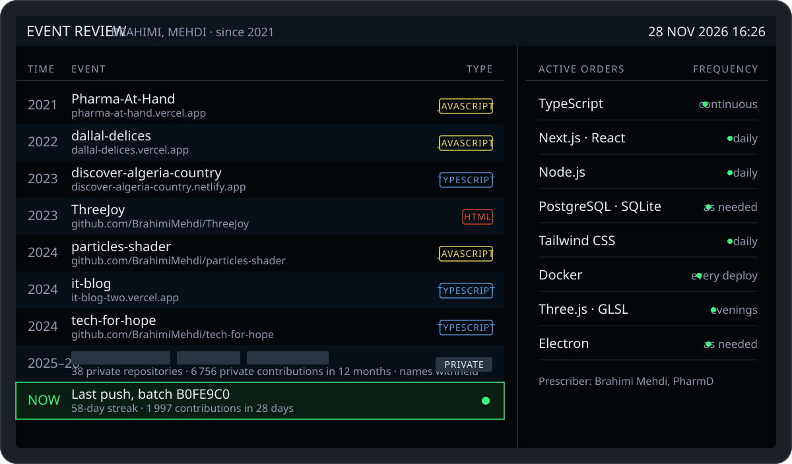

<b>Doctor of Pharmacy who writes software, from Algeria.</b> 
Mostly TypeScript.

<b>Page the on-call</b> 
<a href="https://www.linkedin.com/in/brahimi-mehdi-6540a9286/">LinkedIn</a> &nbsp;·&nbsp;
<a href="https://www.youtube.com/@Brahimimehdi">YouTube</a> &nbsp;·&nbsp;
<a href="https://www.instagram.com/brahimi__mehdi/">Instagram</a> &nbsp;·&nbsp;
<a href="mailto:brahimi.mehdi37@gmail.com">Email</a> &nbsp;·&nbsp;
<a href="https://pharma-at-hand.vercel.app">Pharma at Hand</a>

